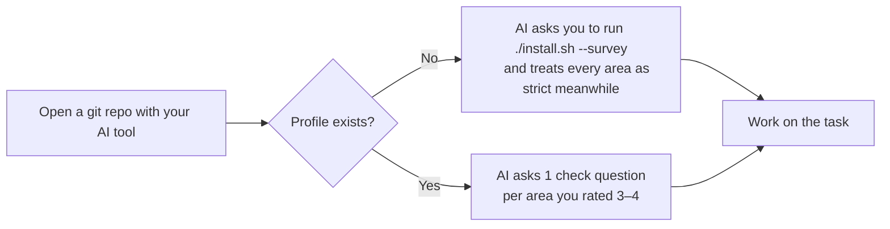

[🇻🇳 Tiếng Việt](../vi/02-getting-started.md) | 🇬🇧 English · [Contents](README.md) · Next: [03 · Daily workflow](03-daily-workflow.md)

*Translated from [docs/vi/02-getting-started.md](../vi/02-getting-started.md), synced at 2026-10-30.*

# 02 · Getting started

> **TL;DR:** Clone the repo, run `./install.sh`, and answer the ~5-minute survey right in the terminal. Open a git repository with your AI tool and type `mentor: status` to check the rules are active.

## 1. Install

**You need:** macOS or Linux with `bash`, `git`, and at least one of: Claude Code, Codex, Antigravity, Cursor.

```bash
git clone <repo-url> ~/Projects/anti-brainrot
cd ~/Projects/anti-brainrot
./install.sh
```

The script does three things:
1. **Finds the AI tools on your machine and copies the rules into each tool's global file.** Those files are `~/.claude/CLAUDE.md`, `~/.codex/AGENTS.md` and `~/.gemini/GEMINI.md`. The rest of each file is left untouched, and the script writes a `.anti-brainrot.bak` backup before changing it.
2. **Copies the templates into `~/.anti-brainrot/templates/`.**
3. **Runs the survey if you don't have a profile yet** (section 2).

**Cursor only:** Cursor has no global rules file. The script copies the rules to your clipboard; paste them into *Settings → Rules → User Rules*.

To install for some tools only: `./install.sh --tools claude,codex`.

## 2. The survey (~5 minutes)

The survey runs in the terminal, in English or Vietnamese. It asks for:
- your role and goal;
- **a 1–4 skill level for each area**. Each level is tied to something concrete you can do: 1 means you've never written it yourself, 2 that you can with an example, 3 that you can write and debug it alone, 4 that you can teach it;
- extra areas to be strict about, the stacks you use, and the brain-rot signs you've noticed;
- how strict the AI should be.

The result is written to `~/.anti-brainrot/profile.md`. **Areas rated 1–2 are strict**, which means new concepts in those areas run as LEARN. To redo the survey (about every 4 weeks is a good rhythm), run `./install.sh --survey`. Your previous levels are kept in the History table so you can see how you've progressed.

## 3. Your first session



- The rules **only run inside a git repository**. Anywhere else, the AI works as usual.
- The AI's first reply opens with a status line, for example: `[mentor v0.3.0] strict=Backend, SQL · learning=none`.
- For each area you rated 3–4, the AI asks one short check question. If you can't answer it, that area drops one level. People tend to rate themselves higher than they are, so this step keeps the profile closer to reality.
- The first time it writes to `.anti-brainrot/` in a repository, the AI adds that folder to `.git/info/exclude`, so nothing personal is committed.

## 4. Check that the rules are active

Type `mentor: status` in your AI tool. A correct answer shows: the rules version, the strict areas, the concepts in LEARN, and any unanswered questions.

If the AI doesn't recognise the command:
- **Claude Code:** type `/memory` to check that `~/.claude/CLAUDE.md` is loaded.
- **Any tool:** open that tool's global file and look for the `anti-brainrot:begin` line.
- **Claude Code asks for permission to read `~/.anti-brainrot/`:** approve it. Otherwise the AI can't read your profile.

## 5. Updating and uninstalling

| Task | Command |
|---|---|
| Update the rules | `git pull && ./install.sh` |
| Redo the survey | `./install.sh --survey` |
| Remove the rules from every tool | `./install.sh --uninstall` (your profile is kept) |
| Remove everything | Uninstall as above, then `rm -rf ~/.anti-brainrot`, then delete `.anti-brainrot/` in each repository |
