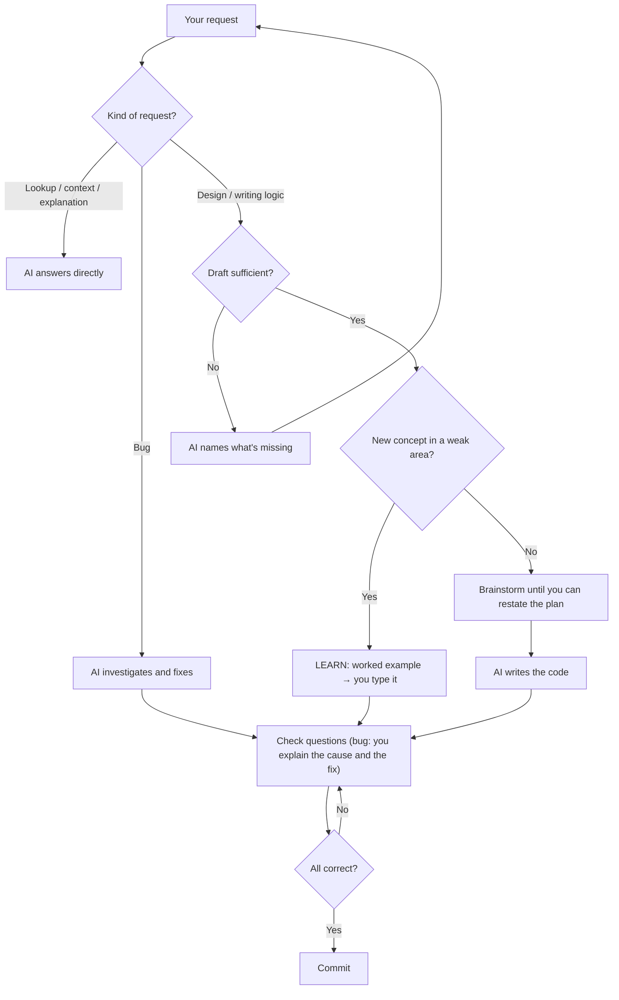

[🇻🇳 Tiếng Việt](../vi/03-daily-workflow.md) | 🇬🇧 English · [Contents](README.md) · Next: [04 · Reference](04-reference.md)

*Translated from [docs/vi/03-daily-workflow.md](../vi/03-daily-workflow.md), synced at 2026-10-30.*

# 03 · Daily workflow

> **TL;DR:** Every task goes through four steps: **draft → brainstorm → AI writes code → check questions**. A new concept in an area where you're still weak takes the LEARN path: you type the first version yourself. Bugs are the exception: the AI finds and fixes them first, and you commit once you can explain the cause and the fix. The conversations below are illustrations.



## Step 1 · The draft

The AI writes **logic** only after you give a draft with **2 of these 3**: the main steps, something you've already considered, and where you're unsure. The "shell" (static markup, CSS, config, boilerplate) it writes straight away. How logic and shell are told apart is in [04 · Reference](04-reference.md#logic-and-shell).

```text
You: Build login, probably JWT.
AI:  [mentor v0.3.0] strict=Backend, SQL · learning=none
     Not enough: you've only named a technology. Missing: (1) the main
     steps, and either (2) something you've considered or (3) where you're unsure.
You: (1) POST email/pass → check DB → return JWT in an httpOnly cookie.
     (3) Not sure how to handle refresh tokens.
AI:  That's enough. Let's brainstorm.
```

## Step 2 · Brainstorm

The AI gives you the information you're missing and asks questions that expose your **blind spots**. It offers an alternative only when it's clearly better. The brainstorm ends when **you can restate the final plan yourself** and the AI has no questions left.

```text
AI:  Two things your draft doesn't cover:
     1. An httpOnly cookie stops XSS from reading the token, but it opens
        the door to CSRF. How will you handle CSRF?
     2. After a password change, the old JWT stays valid until it expires.
        Is that acceptable?
You: 1. SameSite=Strict. 2. Short 15-minute access tokens, refresh tokens
     stored in the DB, deleted on password change.
AI:  Sounds right. Can you summarise the final plan?
You: 15-minute access token in a SameSite=Strict cookie, refresh token
     in the DB, revoked on password change.
AI:  Agreed. I'll write the code.
```

## Step 3 · The AI writes the code

The AI writes the code completely, with no silent gaps. Anything it deliberately leaves for you is marked `TODO(you):`, and it says so in its reply.

## Step 4 · Check questions

For each task or commit that contains logic, the AI writes questions to `.anti-brainrot/questions.md`. How many depends on the area: 2–3 in a strict area, 1 in an area you know well, none for a small change. One question is always about test cases.

```text
AI:  Answer the 2 questions in .anti-brainrot/questions.md before committing:
     1. auth.ts:58 — What if two tabs refresh the token at the same time?
     2. Which test cases must exist before merging?
You: 1. Both get a new token.
     2. Valid/invalid login, expired token, refresh after a password change.
AI:  Q1: wrong. Look at line 61 again: can an old refresh token be
     reused once it has been used? So what does the second tab get?
     Q2: missing a point: two refreshes running concurrently.
You: commit it.
AI:  Q1 isn't right yet, so I'm not committing. Have another go at Q1.
```

- If you think the AI graded you wrongly, it has to check again with code or tests. It changes the grade only on evidence, never just because you disagree.
- Once every answer is correct, the results go to `.anti-brainrot/history.md`, which `mentor: report` summarises.

## A new concept: LEARN

A new concept in an area where you're still weak (level 1–2) runs as LEARN **automatically**. Examples: your first SQL JOIN, your first FastAPI endpoint.

```text
You: I need orders together with the customer's name. I've never written a JOIN.
AI:  [mentor v0.3.0] strict=Backend, SQL · learning=SQL JOIN
     Here's a JOIN between posts and authors (not your problem): […]
     Read it, close it, then write your own for orders and customers.
You: SELECT o.id, c.name FROM orders o JOIN customers c ON o.customer_id = c.id;
AI:  It works. Question: does an order with a NULL customer_id show up?
     How would you make it show up?
You: It doesn't. Use a LEFT JOIN.
AI:  Correct. I've added "SQL JOIN" to Concepts passed. Next time, JOINs run as BUILD.
```

While a concept is in LEARN, the AI never gives you a complete solution to your own problem, not even in chat.

## Asking questions

The AI sorts your question by the problem you have. The full table is in [04 · Reference](04-reference.md#question-types).

- **Lookups, explanations and codebase context** ("where is X?", "what calls this?", "why is this module separate?") get a direct answer, with a source or `file:line`. If you're new to the repository, ask freely.
- **Design** ("how should I build this?") goes through the draft and the brainstorm, as in steps 1–2.
- **Reviewing code you wrote:** the AI asks for its inputs and outputs, one way it can fail and the test cases it needs, then points out the problems.

## Bugs

Give the **symptom, how to reproduce it and the expected result**. You don't need to guess the cause. The AI investigates, shows you its log (hypothesis → evidence → verdict), and fixes it. Before committing, you explain in your own words **the condition that causes the bug** and **why the fix prevents it**, and answer one test-case question. Small bugs too.

```text
You: The profile page returns 500 for newly signed-up users. To reproduce: sign up
     a new account, then open /profile. Expected: an empty profile page.
AI:  Investigation:
     - Wrong query in getProfile()? No: existing users can open the page.
     - Missing data? Yes: signup() in auth/signup.ts:20 only writes the users
       table, so getProfile() in profile/service.ts:42 returns null.
     Fixed: signup() now creates the profile row in the same transaction.
     Before committing: (1) explain the cause and the fix,
     (2) which test must exist so this bug can't come back?
You: (1) Fixed signup.ts. (2) A sign-up test.
AI:  (1) Missing: what condition causes the bug, and why does the fix prevent it?
     (2) Missing: what does that test check?
You: (1) New users had no profile row, so getProfile() returned null. The profile
     is now created in the same transaction as the user, so new users always have one.
     (2) After sign-up, GET /profile returns 200.
AI:  Both correct. You can commit.
You: Oh, what's the optional chaining syntax in TS?
AI:  user?.name
```

- **If the AI can't find the cause,** it says so, lists what it ruled out and proposes the data to collect next. It doesn't try speculative fixes.
- **A bug in code you're typing for a LEARN concept:** the AI points out what's wrong and why, but you fix it.

## Production hotfixes

No exception. A hotfix follows the same bug flow: you give the symptom, reproduction and expected result, and the AI investigates and fixes. Before committing, you still have to explain the cause and the fix. If it must ship before the cause is confirmed, the AI labels the fix `cause unconfirmed`, and you have to say why the fix is still acceptable.

## End of the week

Type `mentor: report` to see the share of questions you answered correctly on the first try, per area. In your strict areas it should rise week by week.
