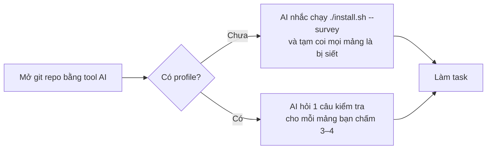

🇻🇳 Tiếng Việt | [🇬🇧 English](../en/02-getting-started.md) · [Mục lục](README.md) · Tiếp: [03 · Làm việc hằng ngày](03-daily-workflow.md)

# 02 · Bắt đầu

> **TL;DR:** Clone repo, chạy `./install.sh`, trả lời survey khoảng 5 phút ngay trên terminal. Mở một git repo bằng tool AI của bạn, gõ `mentor: status` để kiểm tra rules đã chạy chưa.

## 1. Cài đặt

**Cần có:** macOS hoặc Linux có `bash`, `git`, và ít nhất một trong các tool: Claude Code, Codex, Antigravity, Cursor.

```bash
git clone <repo-url> ~/Projects/anti-brainrot
cd ~/Projects/anti-brainrot
./install.sh
```

Script làm 3 việc:
1. **Tìm các tool AI đang có trên máy và chép rules vào file global của từng tool.** Các file đó là `~/.claude/CLAUDE.md`, `~/.codex/AGENTS.md`, `~/.gemini/GEMINI.md`. Phần nội dung khác trong các file này được giữ nguyên, và trước khi sửa, script tạo một bản backup `.anti-brainrot.bak`.
2. **Chép template vào `~/.anti-brainrot/templates/`.**
3. **Chạy survey nếu bạn chưa có profile** (mục 2).

**Riêng Cursor:** Cursor không có file rules global. Script chép rules vào clipboard, bạn dán vào *Settings → Rules → User Rules*.

Chỉ cài cho một số tool: `./install.sh --tools claude,codex`.

## 2. Survey (khoảng 5 phút)

Survey hỏi trên terminal, bằng tiếng Việt hoặc tiếng Anh:
- vai trò và mục tiêu của bạn;
- **mức kỹ năng 1–4 cho từng mảng**. Mỗi mức gắn với một việc cụ thể bạn làm được: 1 là chưa từng tự viết, 2 là viết được khi có ví dụ, 3 là tự viết và debug được, 4 là dạy lại được;
- mảng muốn bị siết thêm, các stack bạn dùng, dấu hiệu "nhũn não" bạn đã gặp;
- AI nên gắt ở mức nào.

Kết quả được ghi vào `~/.anti-brainrot/profile.md`. **Mảng chấm 1–2 bị siết**, nghĩa là khái niệm mới ở mảng đó sẽ chạy LEARN. Muốn làm lại survey (nên làm mỗi khoảng 4 tuần) thì chạy `./install.sh --survey`. Mức cũ được giữ trong bảng History để bạn thấy mình tiến bộ thế nào.

## 3. Session đầu tiên



- Rules **chỉ chạy trong git repo**. Ở thư mục khác, AI làm việc bình thường.
- Câu trả lời đầu tiên của AI mở đầu bằng một dòng trạng thái, ví dụ: `[mentor v0.3.0] strict=Backend, SQL · learning=none`.
- Với mảng bạn tự chấm 3–4, AI hỏi một câu ngắn để kiểm tra. Trả lời không được thì mảng đó bị hạ một mức. Người ta thường tự đánh giá cao hơn thực tế, nên bước này giúp profile sát với bạn hơn.
- Lần đầu ghi file vào `.anti-brainrot/` trong repo, AI thêm thư mục này vào `.git/info/exclude`, nên không có gì cá nhân bị commit.

## 4. Kiểm tra rules đã chạy

Gõ `mentor: status` trong tool AI. Kết quả đúng phải có: version rules, các mảng đang bị siết, các khái niệm đang LEARN, và các câu hỏi chưa trả lời.

Nếu AI không nhận ra lệnh này:
- **Claude Code:** gõ `/memory` để xem `~/.claude/CLAUDE.md` đã được nạp chưa.
- **Mọi tool:** mở file global của tool đó và tìm dòng `anti-brainrot:begin`.
- **Claude Code hỏi quyền đọc `~/.anti-brainrot/`:** hãy bấm cho phép. Nếu không, AI không đọc được profile của bạn.

## 5. Cập nhật và gỡ cài đặt

| Việc | Lệnh |
|---|---|
| Cập nhật rules | `git pull && ./install.sh` |
| Làm lại survey | `./install.sh --survey` |
| Gỡ rules khỏi mọi tool | `./install.sh --uninstall` (profile được giữ lại) |
| Xóa sạch | Gỡ như trên, rồi `rm -rf ~/.anti-brainrot`, rồi xóa `.anti-brainrot/` trong từng repo |
