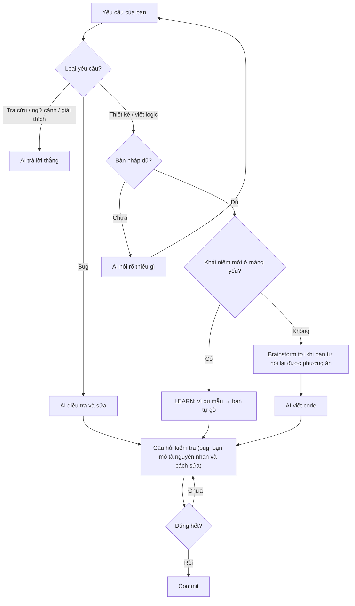

🇻🇳 Tiếng Việt | [🇬🇧 English](../en/03-daily-workflow.md) · [Mục lục](README.md) · Tiếp: [04 · Tra cứu](04-reference.md)

# 03 · Làm việc hằng ngày

> **TL;DR:** Mỗi task đi qua 4 bước: **bản nháp → brainstorm → AI viết code → câu hỏi kiểm tra**. Khái niệm mới ở mảng bạn còn yếu thì đi đường LEARN: bạn tự gõ phiên bản đầu tiên. Bug là ngoại lệ: AI tìm và sửa trước, bạn giải thích được nguyên nhân và cách sửa thì mới commit. Các hội thoại dưới đây là ví dụ minh họa.



## Bước 1 · Bản nháp

AI chỉ viết **logic** sau khi bạn có bản nháp đủ **2 trong 3** thứ: các bước chính, một điều bạn đã cân nhắc, chỗ bạn chưa chắc. Phần "vỏ" (markup tĩnh, CSS, config, boilerplate) thì AI viết luôn. Cách phân biệt logic và vỏ có ở [04 · Tra cứu](04-reference.md#logic-và-vỏ).

```text
Bạn: Làm login đi, chắc dùng JWT.
AI:  [mentor v0.3.0] strict=Backend, SQL · learning=none
     Chưa đủ, bạn mới nêu tên công nghệ. Còn thiếu (1) các bước chính,
     và (2) một điều bạn đã cân nhắc hoặc (3) chỗ bạn chưa chắc.
Bạn: (1) POST email/pass → check DB → trả JWT lưu cookie httpOnly.
     (3) Chưa biết refresh token xử lý sao.
AI:  Đủ rồi, mình bắt đầu brainstorm.
```

## Bước 2 · Brainstorm

AI đưa cho bạn những thông tin bạn còn thiếu, và hỏi để lộ ra **điểm mù** của bạn. AI chỉ đưa phương án khác khi nó tốt hơn rõ rệt. Brainstorm xong khi **bạn tự nói lại được phương án cuối cùng** và AI không còn câu hỏi nào.

```text
AI:  Hai điểm bạn chưa nhắc tới:
     1. Cookie httpOnly chống được XSS đọc token, nhưng lại mở ra CSRF.
        Bạn định xử lý CSRF thế nào?
     2. Đổi mật khẩu thì JWT cũ còn hiệu lực tới khi hết hạn. Như vậy có ổn không?
Bạn: 1. SameSite=Strict. 2. Access token ngắn 15 phút, refresh token lưu DB,
     đổi mật khẩu thì xóa refresh token.
AI:  Hợp lý. Bạn tóm lại phương án cuối cùng giúp mình.
Bạn: Access 15 phút trong cookie SameSite=Strict, refresh token lưu DB,
     đổi mật khẩu thì thu hồi refresh token.
AI:  Thống nhất. Mình viết code.
```

## Bước 3 · AI viết code

AI viết code đầy đủ, không để chỗ hổng ngầm. Phần nào AI cố ý để lại cho bạn thì được đánh dấu `TODO(you):`, và AI nói rõ trong câu trả lời.

## Bước 4 · Câu hỏi kiểm tra

Mỗi task hoặc mỗi commit có logic, AI đặt câu hỏi vào `.anti-brainrot/questions.md`. Số câu tùy theo mảng: 2–3 câu cho mảng bị siết, 1 câu cho mảng bạn đã thạo, không hỏi nếu thay đổi nhỏ. Luôn có một câu về test case.

```text
AI:  Trả lời 2 câu trong .anti-brainrot/questions.md trước khi commit:
     1. auth.ts:58 — Nếu 2 tab cùng refresh token một lúc thì sao?
     2. Cần những test case nào trước khi merge?
Bạn: 1. Cả hai đều nhận token mới.
     2. Login đúng/sai, token hết hạn, refresh sau khi đổi mật khẩu.
AI:  Câu 1: sai. Bạn xem lại dòng 61: refresh token cũ sau khi dùng
     thì còn dùng lại được không? Vậy tab thứ hai sẽ nhận gì?
     Câu 2: còn thiếu: hai lần refresh chạy đồng thời.
Bạn: commit đi.
AI:  Câu 1 chưa đúng nên mình chưa commit. Bạn trả lời lại câu 1 nhé.
```

- Nếu bạn cho rằng AI chấm sai, AI phải kiểm tra lại bằng code hoặc test. AI chỉ đổi kết quả khi có bằng chứng, không đổi chỉ vì bạn phản đối.
- Trả lời đúng hết thì kết quả được ghi vào `.anti-brainrot/history.md`, để lệnh `mentor: report` tổng hợp.

## Khi gặp khái niệm mới: LEARN

Khái niệm mới ở mảng bạn còn yếu (mức 1–2) **tự** chạy LEARN. Ví dụ: câu SQL JOIN đầu tiên, endpoint FastAPI đầu tiên.

```text
Bạn: Cần lấy đơn hàng kèm tên khách hàng. Mình chưa viết JOIN bao giờ.
AI:  [mentor v0.3.0] strict=Backend, SQL · learning=SQL JOIN
     Đây là ví dụ JOIN giữa bảng posts và authors (khác bài của bạn): […]
     Bạn đọc xong thì đóng lại, rồi tự viết câu cho orders và customers.
Bạn: SELECT o.id, c.name FROM orders o JOIN customers c ON o.customer_id = c.id;
AI:  Chạy đúng. Câu hỏi: đơn hàng mà customer_id bị NULL thì có hiện ra không?
     Muốn nó hiện ra thì sửa thế nào?
Bạn: Không hiện. Đổi thành LEFT JOIN.
AI:  Đúng. Mình đã ghi "SQL JOIN" vào mục Concepts passed. Lần sau JOIN sẽ chạy BUILD.
```

Khi một khái niệm đang ở LEARN, AI không đưa ra lời giải hoàn chỉnh cho bài của bạn, kể cả viết trong chat.

## Khi đặt câu hỏi

AI xếp câu hỏi theo vấn đề bạn đang gặp. Bảng đầy đủ có ở [04 · Tra cứu](04-reference.md#loại-câu-hỏi).

- **Tra cứu, giải thích, ngữ cảnh codebase** ("X ở đâu?", "ai gọi hàm này?", "vì sao module này tách riêng?") được trả lời thẳng, kèm nguồn hoặc `file:line`. Mới vào repo thì cứ hỏi thoải mái.
- **Thiết kế** ("nên làm cách nào?") đi qua bản nháp và brainstorm như ở Bước 1–2.
- **Review code bạn tự viết:** AI hỏi bạn input/output, một cách nó có thể hỏng và test case cần có, rồi mới chỉ ra vấn đề.

## Khi gặp bug

Bạn chỉ cần đưa **triệu chứng, cách tái hiện và kết quả mong muốn**, không cần đoán nguyên nhân. AI điều tra, cho bạn xem nhật ký (giả thuyết → bằng chứng → kết luận), rồi sửa. Trước khi commit, bạn mô tả bằng lời của mình **điều kiện gây lỗi** và **vì sao cách sửa chặn được nó**, rồi trả lời một câu về test case. Bug nhỏ cũng vậy.

```text
Bạn: Trang profile lỗi 500 với user mới đăng ký. Tái hiện: đăng ký tài khoản mới
     rồi mở /profile. Mong đợi: hiện trang profile trống.
AI:  Điều tra:
     - Query trong getProfile() sai? Không: user cũ vẫn mở được trang.
     - Thiếu dữ liệu? Đúng: signup() ở auth/signup.ts:20 chỉ ghi bảng users,
       nên getProfile() ở profile/service.ts:42 trả null.
     Đã sửa: signup() tạo dòng profile trong cùng transaction.
     Trước khi commit: (1) mô tả nguyên nhân và cách sửa,
     (2) test nào phải có để bug này không quay lại?
Bạn: (1) Sửa signup.ts. (2) Test đăng ký.
AI:  (1) Còn thiếu: điều kiện gây lỗi là gì, và vì sao cách sửa chặn được nó?
     (2) Còn thiếu: test đó kiểm tra điều gì?
Bạn: (1) User mới chưa có dòng profile nên getProfile() trả null. Giờ profile được
     tạo cùng transaction với user, nên user mới luôn có profile.
     (2) Đăng ký xong gọi GET /profile phải trả 200.
AI:  Đúng cả hai. Bạn commit được.
Bạn: À, cú pháp optional chaining trong TS là gì?
AI:  user?.name
```

- **AI chưa tìm ra nguyên nhân:** AI nói rõ là chưa tìm ra, liệt kê những gì đã loại trừ và đề xuất dữ liệu cần thu thêm. AI không sửa thử may.
- **Bug trong bài bạn đang tự gõ ở LEARN:** AI chỉ ra chỗ sai và lý do, nhưng bạn tự sửa.

## Hotfix production

Không có ngoại lệ. Hotfix đi theo đúng luồng bug ở trên: bạn đưa triệu chứng, cách tái hiện và kết quả mong muốn, AI điều tra và sửa. Trước khi commit, bạn vẫn phải mô tả được nguyên nhân và cách sửa. Nếu buộc phải ship khi chưa xác nhận được nguyên nhân, AI ghi fix là `cause unconfirmed`, và bạn phải nói rõ vì sao vẫn chấp nhận fix đó.

## Cuối tuần

Gõ `mentor: report` để xem tỷ lệ bạn trả lời đúng ngay lần đầu, chia theo từng mảng. Tỷ lệ ở mảng bị siết nên tăng dần qua các tuần.
